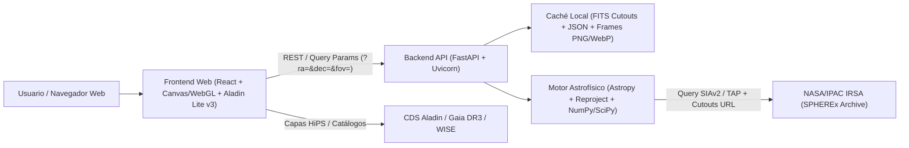

# AGENTS.md — Guía Maestra del Proyecto y Contexto para Agentes de IA

> **Proyecto:** GrajX — Visor Web Público Multi-Época y Multi-Banda para la Misión **SPHEREx** de la NASA  
> **Evento:** NASA Space Apps Challenge 2026 — Sede Hermosillo, Mx (Hackathon de 48 horas)  
> **Propósito de este documento:** Servir como **archivo de contexto único (Single Source of Truth)** para agentes de IA (Copilot, Antigravity, Cursor, Claude, etc.) y como **guía arquitectónica, científica y operativa** para el equipo humano de desarrollo.

---

## 1. Resumen Ejecutivo y Contexto del Reto

Desde mayo de 2025, la misión **SPHEREx** (*Spectro-Photometer for the History of the Universe, Epoch of Reionization and Ices Explorer*) de la NASA mapea todo el cielo cada **6 meses** en **102 bandas espectrales de luz infrarroja cercana** ($0.75\text{–}5.0\,\mu\text{m}$), recolectando datos de más de mil millones de objetos astronómicos (estrellas cercanas, enanas marrones, asteroides, cometas, exoplanetas, cuásares, supernovas y galaxias).

A diferencia de cámaras tradicionales con filtros discretos, SPHEREx utiliza **Filtros Variables Lineales (LVF)** montados sobre **6 conjuntos de detectores** (denominados típicamente `D1` a `D6`, con ~17 canales espectrales por detector). Esto hace al observatorio excepcionalmente sensible a firmas moleculares de agua ($\text{H}_2\text{O}$), hielo, dióxido de carbono ($\text{CO}_2$), monóxido de carbono ($\text{CO}$) e hidrocarburos, además de revelar objetos fríos y tenues invisibles en el óptico.

### Objetivo Central del Reto
Construir una **herramienta web pública, rápida y fácil de entender para cualquier persona** (astrónomos y científicos ciudadanos) que permita:
1. Ingresar coordenadas celestes de un parche de cielo: **Ascensión Recta (`RA`)** y **Declinación (`Dec`)**, o seleccionar un objeto por nombre.
2. Visualizar la **serie temporal de imágenes** de ese parche como un **vídeo interactivo / animador tipo *blink comparator*** para detectar fácilmente **objetos en movimiento** (paralaje, movimiento propio, asteroides/cometas) y **cambios de brillo** (estrellas variables, supernovas).
3. Responder a las **Consideraciones Potenciales** que elevan el valor científico del proyecto (coadición de los 6 detectores, espectros al vuelo, suma/resta multi-época, selector de Campo de Visión `FOV`, superposición con Gaia/WISE, URLs compartibles/incrustables y visualización de banderas de calidad/contaminación).

---

## 2. Auditoría del Repositorio Actual y Hallazgo Crítico sobre los Notebooks

### 2.1 Inventario Actual del Espacio de Trabajo
Al momento de generar este análisis, el repositorio contiene:
- `prompt.md` — Especificación completa del reto, objetivos, 5 objetos de prueba y consideraciones opcionales.
- `README.md` — Descripción base del repositorio *GrajX - SPHEREx - Space Apps Challenge 2026 - Hermosillo, Mx*.
- `Untitled.ipynb` — Notebook vacío listo para experimentación en Python `3.14.10`.
- `LICENSE` y `.gitignore`.
- `.venv/` — Entorno virtual Python **`3.14.10`** con los siguientes paquetes ya instalados:
  - Ciencia de datos / Astronomía: `astropy==8.0.2`, `astropy-iers-data`, `numpy==2.5.4`, `pandas==3.1.1`, `matplotlib==3.11.2`, `pillow==13.0.0`, `pyerfa==2.0.1.5`.
  - Red / Jupyter: `requests==2.34.2`, `httpx==0.28.1`, `jupyterlab==4.6.6`, `notebook==7.6.5`, `ipykernel==7.4.0`.
- `NEOSSAT_Tutorial/` — Subproyecto clonado con documentación (`README.md`) y notebooks en inglés y francés:
  - `NEOSSAT_Tutorial/code/01_ Extracting Data and Visualization.ipynb`
  - `NEOSSAT_Tutorial/code/02_Pre Processing and Analysis.ipynb`

---

### 2.2 Hallazgo Técnico Crítico: NEOSSat vs. SPHEREx (IRSA)

> [!IMPORTANT]
> **Atención Agentes de IA y Equipo Humano:** Los notebooks dentro de `NEOSSAT_Tutorial/` corresponden al telescopio espacial óptico canadiense **NEOSSat** (consultado vía FTP de la CSA `ftp.asc-csa.gc.ca` o mediante `astroquery.cadc` sobre tablas `caom2`), **NO** consultan directamente el archivo de la misión **SPHEREx** de la NASA.
>
> **¿Por qué nos sirven y qué debemos adaptar?**
> Los notebooks de NEOSSat nos proveen el **pipeline probado de procesamiento de imágenes FITS y detección de movimiento**, mientras que la **ingesta de datos de SPHEREx** debe apuntar al archivo oficial **NASA/IPAC Infrared Science Archive (IRSA)** usando protocolos IVOA (**SIAv2** y **TAP/ADQL**) documentados en `Caltech-IPAC/irsa-tutorials`.

#### A) Qué reutilizar directamente de `NEOSSAT_Tutorial`
Del archivo `NEOSSAT_Tutorial/code/02_Pre Processing and Analysis.ipynb`, el equipo y los agentes deben extraer y modularizar las siguientes técnicas hacia nuestro backend:
1. **Lectura FITS en punto flotante** (`read_fits_data`): carga con `astropy.io.fits` convirtiendo a `np.float64` (en SPHEREx hay que considerar archivos **Multi-Extension FITS [MEF]**).
2. **Estiramiento dinámico de contraste (*percentile stretch*)**:
   ```python
   vmin, vmax = np.percentile(data, [5, 95])  # O ZScaleInterval / AsinhStretch para mejor rango NIR
   normalized = np.clip((data - vmin) / (vmax - vmin), 0, 1)
   image_8bit = (normalized * 255).astype(np.uint8)
   ```
3. **Apilamiento por mediana (*Median Stacking*)** (`stack_images`): `np.median(data_cube, axis=0)` para eliminar rayos cósmicos/ruido y elevar la relación señal-ruido (SNR). *(Nota: en SPHEREx los frames deben **reproyectarse al mismo WCS** antes de apilar o restar).*
4. **Detección de objetos en movimiento por sustracción temporal** (`detect_moving_objects`):
   - Calcular imagen de referencia por mediana: `median_image = np.median(data_cube, axis=0)`.
   - Calcular cubo de diferencias: `difference_cube = data_cube - median_image`.
   - Umbralización estadística: `threshold = np.std(difference_cube) * 3`.
   - Limpieza morfológica: `binary_opening(..., footprint=np.ones((3, 3)))` + `remove_small_objects(..., min_size=20)`.
5. **Detección de trazas rápidas (*Streaklets*)** (`detect_streaklets`): suavizado Gaussiano (`sigma=1`) + detector de segmentos de línea (**LSD**, `pylsd.lsd`) + dilatación binaria (`disk(1)`) para identificar asteroides rápidos, satélites o basura espacial que dejan líneas en un solo cuadro.
6. **Generación de secuencias animadas** (`create_gif`): exportación de cuadros normalizados con `imageio.mimsave(..., format='GIF', duration=duration, loop=0)` o MP4/WebM para el reproductor web.

#### B) Cómo extraer los datos reales de SPHEREx (IRSA — `Caltech-IPAC/irsa-tutorials`)
Los productos primarios de SPHEREx en IRSA son **archivos Multi-Extension FITS (MEF)** de gran tamaño (cientos de MB cada exposición). **Nunca se deben descargar MEFs completos en tiempo real para una petición web.** En su lugar, se debe consultar el catálogo y solicitar **Cutouts (recortes espaciales)** directamente al servidor de IRSA.

##### Opción 1: Consulta vía `astroquery.ipac.irsa` (SIAv2)
```python
import astropy.units as u
from astropy.coordinates import SkyCoord
from astroquery.ipac.irsa import Irsa

# Listar colecciones SPHEREx disponibles (ej. spherex_qr3, spherex_dr1, spherex)
collections = Irsa.list_collections(servicetype='SIA', filter='spherex')

# Consultar imágenes que traslapen con la coordenada y radio FOV
coord = SkyCoord(ra=133.79513 * u.deg, dec=-7.24515 * u.deg, frame='icrs')
results = Irsa.query_sia(pos=(coord, 0.1 * u.deg), collection='spherex_dr1')
# O usar collection='spherex' según las colecciones activas devueltas por list_collections
```

##### Opción 2: Consulta avanzada vía TAP / ADQL (`pyvo` o `Irsa.query_tap`) — **Recomendada para el Backend**
Permite filtrar por detector (`SPHEREx-D1` .. `SPHEREx-D6`), ordenar cronológicamente por época (`time_bounds_lower`) y construir URLs de **Cutout** al vuelo:
```python
import pyvo
import astropy.units as u

service = pyvo.dal.TAPService("https://irsa.ipac.caltech.edu/TAP")

ra, dec, size_deg = 133.79513, -7.24515, 0.1  # Ej. WISE 0855, FOV 0.1 deg (6 arcmin)

query = f"""
SELECT
    'https://irsa.ipac.caltech.edu/' || a.uri || '?center={ra},{dec}d&size={size_deg}' AS cutout_uri,
    p.planeid,
    p.time_bounds_lower,
    p.time_bounds_upper,
    p.energy_bandpassname,
    p.energy_bounds_lower,
    p.energy_bounds_upper
FROM spherex.artifact a
JOIN spherex.plane p ON a.planeid = p.planeid
WHERE 1 = CONTAINS(POINT('ICRS', {ra}, {dec}), p.poly)
ORDER BY p.time_bounds_lower ASC
"""
results = service.search(query).to_table()
```
> **Nota:** Si el esquema exacto de tablas o `collection` cambia tras una nueva liberación de datos de SPHEREx, ejecutar primero `Irsa.list_collections(servicetype='SIA', filter='spherex')` o inspeccionar `TAP_SCHEMA.tables` para descubrir los nombres vigentes sin hardcodear versiones obsoletas.

##### Estructura típica de un FITS / Cutout de SPHEREx (MEF)
Un cutout FITS de SPHEREx suele contener múltiples HDUs (*Header Data Units*) que deben manejarse correctamente con `astropy.io.fits`:
- `PRIMARY` o `IMAGE`: Flujo calibrado de la imagen y su cabecera WCS espacial (`CRVAL1`, `CRVAL2`, `CDELT`/`PC`).
- `FLAGS` (bitmask): Máscara de calidad por píxel (rayos cósmicos, píxeles calientes, saturación, contaminación/persistencia).
- `VARIANCE` / `ERR`: Mapa de varianza o incertidumbre por píxel (fundamental para ponderar coadiciones y calcular barras de error en espectros).
- `ZODI` / `PSF` / `WCS` espectral: Componentes de fondo zodiacal y calibración de longitud de onda ($\lambda$) según posición $(x, y)$ en el detector LVF.

---

## 3. Catálogo de los 5 Objetos de Prueba Obligatorios (Benchmark Targets)

El reto exige validar explícitamente la plataforma con los siguientes **5 objetos astronómicos**. Deben existir como **accesos rápidos ("Quick Presets")** en la interfaz web y tener datos pre-descargados/cacheados en disco para garantizar una demo infalible incluso sin conexión estable.

| # | Objeto | Tipo Astrofísico | Fenómeno a Demostrar | RA (J2000 Sexagesimal) | Dec (J2000 Sexagesimal) | RA (Grados ICRS) | Dec (Grados ICRS) | Estrategia de Visualización |
|---|---|---|---|---|---|---|---|---|
| 1 | **Barnard's Star** *(GJ 699)* | Enana roja cercana (~5.96 a.l.) | **Movimiento propio más rápido conocido** ($10.3''/\text{año}$) + paralaje | `17h 57m 48.50s` | `+04° 41' 36.1"` | `269.45208` | `+4.69336` | *Blink timelapse* + modo resta ($I_t - I_0$) mostrando el típico **dipolo blanco/negro** del desplazamiento; superposición con catálogo Gaia. |
| 2 | **Epsilon Indi B** *($\varepsilon$ Ind Ba/Bb)* | Sistema binario de enanas marrones (T1 + T6, ~11.9 a.l.) | **Alto movimiento propio** ($4.7''/\text{año}$) + movimiento orbital del par binario | `22h 04m 10.5s` | `-56° 46' 55"` | `331.04390` | `-56.78194` | Coadición de detectores de onda larga (NIR), contraste Asinh para distinguir las enanas marrones junto al brillo de $\varepsilon$ Ind A. |
| 3 | **WISE 0855** *(WISE 0855–0714)* | Enana marrón fría tipo Y (~7.27 a.l., ~250 K) | **Movimiento rápido** ($8.1''/\text{año}$) y emisión extrema solo en **infrarrojo** | `08h 55m 10.831s` | `-07° 14' 42.53"` | `133.79513` | `-7.24515` | **Caso estrella para SPHEREx:** invisible en el óptico; resaltar bandas $3.5\text{–}5.0\,\mu\text{m}$ (`D5`/`D6`), comparar contra capa WISE y graficar absorción molecular de $\text{H}_2\text{O}$/$\text{CH}_4$. |
| 4 | **RW Aurigae** *(RW Aur)* | Estrella joven variable tipo T Tauri | **Variabilidad fotométrica abrupta** (oscurecimiento por polvo circumestelar) | `05h 07m 49.46s` | `+30° 24' 04.8"` | `76.95608` | `+30.40133` | En el vídeo la estrella **cambia drásticamente de brillo** sin moverse; mostrar curva de luz temporal, mapa de diferencia de flujo y variación espectral NIR. |
| 5 | **R Draconis** *(R Dra)* | Estrella gigante roja variable tipo Mira | **Pulsación periódica de gran amplitud** (cambio de brillo + temperatura) | `16h 32m 40.23s` | `+66° 45' 17.9"` | `248.16763` | `+66.75497` | Animación multi-época destacando cambios de flujo + comparación de espectro entre máximo y mínimo de brillo (bandas de vapor de agua/CO). |

*(Nota sobre coordenadas de `prompt.md`: para `WISE 0855`, el prompt entrega exactamente `08h55m10.831s, -7d14m42.53s`.)*

---

## 4. Arquitectura Propuesta y Solución a las Consideraciones Potenciales

### 4.1 Diagrama de Arquitectura del Sistema



### 4.2 Cómo resolver cada "Consideración Potencial" del Reto

| Consideración del Prompt | Solución Técnica Concreta | Prioridad |
|---|---|---|
| **1. Fácil actualización con nuevos datos de SPHEREx** | No empaquetar datasets estáticos como fuente única. Consultar **IRSA TAP/SIA en tiempo real** usando descubrimiento dinámico de colecciones (`spherex_*`), manteniendo la carpeta local únicamente como caché LRU/disco de cutouts recientes y presets de demo. | Alta (MVP) |
| **2. Uso creativo de las 102 bandas y 6 conjuntos de detectores** | Agrupar las exposiciones por cada uno de los **6 detectores (`D1`–`D6`)**, coadicionar (sumar/promediar ponderado) dentro de cada detector para disparar el SNR, asignar colores falsos (**ej. RGB = D1/D3/D5**) y **generar espectros al vuelo** ($0.75\text{–}5.0\,\mu\text{m}$) graficando el flujo por longitud de onda al hacer clic en cualquier píxel/fuente. | Alta (Diferenciador) |
| **3. Sumar o restar imágenes de diferentes momentos** | Reproyectar todas las épocas a una malla WCS común (`reproject.reproject_interp`) y exponer modos de visualización: **Original (Blink)**, **Suma/Mediana (Stack para objetos tenues)**, **Resta entre épocas ($I_t - I_{\text{ref}}$ o $I_t - I_{\text{mediana}}$)** con mapa de color divergente (azul = desapareció/se movió, rojo = apareció/aumentó brillo) y **Máscara automática de movimiento** heredada de `NEOSSAT_Tutorial`. | Alta (Core) |
| **4. Elección del Campo de Visión (`FOV`)** | Control deslizante de `FOV` (ej. `2'`, `5'`, `10'`, `20'`, `30'`) con **indicador estimado de tiempo de transferencia** y tamaño en píxeles antes de consultar el cutout a IRSA, permitiendo rastrear objetos de movimiento ultra rápido. | Alta (MVP) |
| **5. Superponer otros telescopios (Gaia / WISE)** | Integrar **Aladin Lite v3** (`aladin.cds.unistra.fr`) sincronizado con el centro `(RA, Dec, FOV)` para alternar/superponer mapas **AllWISE** (infrarrojo de referencia de 2010, ideal para comparar movimiento de 15+ años hasta SPHEREx 2025+) y superponer marcadores/vectores de movimiento propio de **Gaia DR3**. | Media-Alta |
| **6. Coordenadas en la URL (Incrustable / Embebible)** | Sincronizar todo el estado de la vista con la URL del navegador: `?ra=133.79513&dec=-7.24515&fov=6&mode=diff&detector=D5&embed=1`. Soportar un modo `embed=1` limpio (sin barras laterales ni cabecera) pensado para `<iframe>` en proyectos de ciencia ciudadana como Backyard Worlds / Zooniverse. | Alta (Fácil y alto impacto) |
| **7. Metadatos e indicadores de contaminación** | Exponer en un panel lateral/inspector por frame: fecha de observación (`MJD` / ISO UTC), tiempo de exposición, detector/banda ($\lambda_{\text{eff}}$), y decodificar la extensión `FLAGS` / cabeceras FITS para mostrar **semáforo de calidad** (rayos cósmicos, persistencia, saturación, luz dispersa). | Media |

---

## 5. Estructura de Proyecto Recomendada y Entorno Técnico

### 5.1 Estructura de Directorios Objetivo
Para mantener un repositorio limpio entre el backend científico, la interfaz web y los cuadernos de pruebas:

```text
GrajX---SPHEREx---Space-Apps-Challenge-2026---Hermosillo-Mx/
├── AGENTS.md                   # Este archivo (contexto maestro y guía del equipo)
├── prompt.md                   # Enunciado original del reto
├── README.md                   # Documentación pública final y capturas para jueces
├── NEOSSAT_Tutorial/           # Referencia original de procesamiento FITS / detección
├── notebooks/                  # Notebooks de exploración SPHEREx (evolución de Untitled.ipynb)
├── data/
│   ├── presets/                # Cutouts FITS pre-cacheados de los 5 objetos de prueba
│   └── cache/                  # Caché temporal de consultas IRSA (ignorado en git)
├── backend/
│   ├── requirements.txt
│   ├── app/
│   │   ├── main.py             # API FastAPI + endpoints (/search, /sequence, /spectrum, /gif)
│   │   ├── irsa_client.py      # Consultas TAP/SIA a IRSA y descarga de cutouts
│   │   ├── fits_processor.py   # Reproyección WCS, stacking, resta, flags, normalización
│   │   ├── motion_detector.py  # Lógica portada de NEOSSAT_Tutorial (3σ mask + LSD streaklets)
│   │   └── presets.py          # Catálogo con coordenadas de los 5 objetos obligatorios
│   └── tests/
└── frontend/
    ├── package.json
    └── src/
        ├── components/
        │   ├── SkySearchBar.tsx      # Input RA/Dec (grados o sexagesimal), nombre, presets, FOV
        │   ├── BlinkPlayer.tsx       # Reproductor vídeo/secuencia frame-a-frame (Play/Pause/FPS/Mode)
        │   ├── SpectrumChart.tsx     # Gráfico interactivo de espectro al vuelo (0.75–5.0 µm)
        │   ├── AladinOverlay.tsx     # Vista paralela / overlay WISE & Gaia DR3
        │   └── MetadataPanel.tsx     # Bandas, MJD, indicadores de contaminación y botón Embed
        └── App.tsx
```

### 5.2 Dependencias Necesarias para Completar `.venv`
El entorno `.venv` actual (`Python 3.14.10`) ya cuenta con `astropy`, `numpy`, `pandas`, `matplotlib`, `pillow`, `requests` y `httpx`. Para habilitar la conectividad a IRSA, el reproyectado WCS, el procesamiento avanzado de imágenes y la API web, ejecutar:

```bash
source .venv/bin/activate
pip install astroquery pyvo reproject scipy scikit-image imageio fastapi uvicorn pydantic
```
*(Nota: Si alguna librería como `pylsd` o `opencv-python-headless` presenta incompatibilidad con Python 3.14 por falta de wheels precompilados, sustituir detección de líneas por `skimage.transform.probabilistic_hough_line` que ya forma parte de `scikit-image`, o evaluar crear un entorno paralelo con Python 3.11/3.12 si se requiere algún wheel específico).*

---

## 6. Guía Operativa para el Equipo Humano (Plan de Batalla 48 Horas)

### 6.1 División de Roles Recomendada (4 Tracks Paralelos)
1. **Track A — Ingesta Astrofísica y Datos SPHEREx (Python / Jupyter / IRSA):**
   - Validar en un notebook la consulta a IRSA (`Irsa.query_sia` y `pyvo` TAP) para los **5 objetos de prueba**.
   - Inspeccionar la estructura real de los HDUs de los cutouts de SPHEREx (`IMAGE`, `VARIANCE`, `FLAGS`, WCS) y guardar cutouts locales en `data/presets/` para los 5 objetivos.
2. **Track B — Motor de Procesamiento y Backend API (FastAPI + Astropy):**
   - Portar las funciones de `NEOSSAT_Tutorial` (stacking, resta temporal, umbral $3\sigma$) agregando **reproyección WCS** (`reproject`) para alinear frames de distintas épocas.
   - Implementar endpoints REST:
     - `GET /api/presets` — Devuelve los 5 objetos de prueba con metadatos.
     - `GET /api/frames?ra=...&dec=...&fov=...&mode=(blink|stack|diff)&detector=(all|D1..D6)` — Devuelve lista ordenada por tiempo de frames PNG/WebP con sus metadatos, WCS y flags de contaminación.
     - `GET /api/spectrum?ra=...&dec=...&fov=...` — Extrae flujo vs. longitud de onda ($\mu\text{m}$) en una apertura centrada en el objeto seleccionado.
     - `GET /api/export/gif?...` — Descarga animación GIF/MP4 generada en el servidor.
3. **Track C — Frontend Interactivo y Experiencia de Usuario (Web):**
   - Construir interfaz limpia de tema oscuro (*astronomy-first UI*), barra de búsqueda que acepte tanto sexagesimal (`08h55m10.831s -7d14m42.53s`) como grados decimales (`133.79513, -7.24515`) y botones de 1 clic para los 5 objetivos.
   - Reproductor de vídeo/secuencia con controles: `Play/Pause`, slider de velocidad (`FPS`), selector de modo (`Blink`, `Suma / Coadd`, `Resta / Diff`), selector de detector (`D1–D6` o `Falso Color RGB`) y slider de `FOV`.
   - Sincronización bidireccional con parámetros URL (`?ra=...&dec=...&fov=...&embed=true`) + botón "Copiar enlace / Código Iframe".
   - Integración con **Aladin Lite v3** para alternar contra **WISE** y **Gaia DR3**.
4. **Track D — Validación Científica, Documentación y Pitch:**
   - Verificar que el movimiento de **Barnard's Star**, **Epsilon Indi B** y **WISE 0855** y la variabilidad de **RW Aurigae** y **R Draconis** se aprecien claramente en la UI.
   - Redactar `README.md`, grabar demo de respaldo de 30–60s y preparar el pitch enfocando el impacto en ciencia ciudadana (descubrimiento de Planeta 9, enanas marrones y cometas).

### 6.2 Cronograma Sugerido (H0 – H48)
- **Horas 0 – 8 (Cimientos y Datos):** Probar acceso IRSA en notebook, descargar cutouts de los 5 objetos benchmark, levantar esqueleto FastAPI y esqueleto Frontend con reproductor básico usando frames de prueba.
- **Horas 8 – 20 (Core Científico + UI):** Conectar Backend con Frontend en vivo; implementar reproyección WCS + modo Suma + modo Resta; agregar parsing de coordenadas sexagesimales/decimales y deep-linking en URL.
- **Horas 20 – 34 (Diferenciadores Estrellas):** Coadición por los 6 detectores (`D1–D6`), espectros al vuelo interactivos al hacer clic sobre el parche, panel de banderas de contaminación y superposición Aladin Lite (Gaia/WISE).
- **Horas 34 – 42 (Endurecimiento y QA):** Probar los 5 objetos obligatorios en vivo, activar modo caché/fallback en disco para evitar fallos de red en presentación, pulir diseño responsivo y modo `embed`.
- **Horas 42 – 48 (Congelación y Pitch):** Congelar código (`main`), actualizar `README.md`, capturar GIFs/vídeos y ensayar la demostración en vivo.

---

## 7. Directrices Estrictas para Agentes de IA que Trabajen en este Repositorio

Todo agente de IA que genere o modifique código en este proyecto **DEBE** cumplir estas reglas invariantes:

1. **Nunca confundir NEOSSat con SPHEREx en producción:** Usar `NEOSSAT_Tutorial/` exclusivamente como referencia algorítmica (procesamiento FITS, stacking, resta, máscara de movimiento, GIF). Las consultas de datos del producto final deben dirigirse a **IRSA** (`https://irsa.ipac.caltech.edu/TAP` / `astroquery.ipac.irsa`) usando colecciones `spherex*`.
2. **Normalizar siempre las coordenadas al estándar ICRS (grados decimales):** Aceptar entradas del usuario en sexagesimal (`08h55m10.831s`, `-7d14m42.53s`, `17:57:48.5 +04:41:36`) o decimal, pero convertir inmediatamente usando `astropy.coordinates.SkyCoord` antes de pasar parámetros a queries TAP/SIA o URLs.
3. **Siempre reproyectar WCS antes de operar matemáticamente entre épocas:** Dos exposiciones de SPHEREx tomadas con 6 meses de diferencia tienen distinta orientación (ángulo de posición / *roll angle*) y proyección de píxeles. **Nunca restar ni sumar arrays crudos sin reproyectarlos antes a una rejilla WCS común** (p. ej. con `reproject.reproject_interp` o `astropy.wcs`). De lo contrario aparecerán falsos dipolos por desalineación.
4. **Usar Cutouts de IRSA y Caché local:** Solicitar recortes espaciales (`?center={ra},{dec}d&size={fov}`) en vez de descargar archivos MEF completos. Cachear respuestas FITS en disco con clave determinista `(ra_rounded, dec_rounded, fov, band, release)` y garantizar que los 5 objetos de prueba tengan fallback local en `data/presets/`.
5. **Escalamiento de píxeles astronómico (no lineal):** Las fuentes astronómicas tienen enorme rango dinámico. Usar `astropy.visualization.ZScaleInterval` o `AsinhStretch` (o percentiles `[1, 99.5]` / `[5, 95]` como fallback) manejando valores `NaN`/`Inf` con `np.nan_to_num` antes de convertir a PNG/WebP de 8 bits.
6. **Preservar información de calidad y unidades:** Al leer FITS de SPHEREx, extraer explícitamente el HDU de flags/calidad (`FLAGS`) y las unidades de flujo (ej. `MJy/sr` o `Jy`) junto con la fecha `MJD` de observación para mostrarlos en el visor web.
7. **Mantener las URLs reproducibles:** Cualquier cambio en parámetros de observación (`ra`, `dec`, `fov`, `mode`, `detector`, `fps`, `embed`) debe reflejarse en la query string del navegador para permitir compartir descubrimientos e incrustar la herramienta en `<iframe>`.
8. **No romper el repositorio:** Mantener código modular y desacoplado (`backend/` separado de `frontend/`), no subir binarios FITS pesados ni contenido de `data/cache/` a Git (añadirlos a `.gitignore`).
