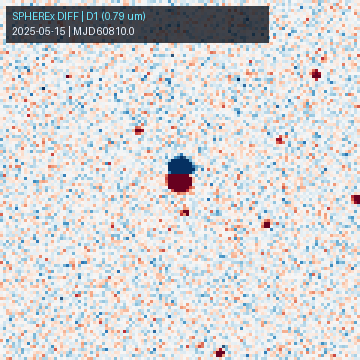
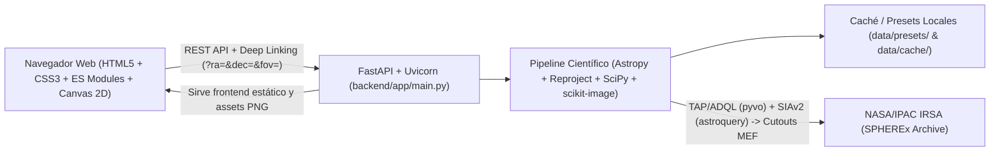

# CepheusLive — Visor Web Público Multi-Época y Multi-Banda para SPHEREx (NASA)

> **NASA Space Apps Challenge 2026 — Sede Hermosillo, Mx**  
> Herramienta web pública e interactiva para explorar series temporales del cielo en el infrarrojo cercano (`0.75–5.0 µm`, 102 canales espectrales y 6 conjuntos de detectores LVF `D1–D6`) de la misión **SPHEREx** de la NASA, diseñada para que astrónomos y científicos ciudadanos detecten objetos en movimiento y variabilidad fotométrica con facilidad.

<p align="center">
  
  <br />
  <sub>Secuencia exportada desde <code>/api/export/gif</code> para <strong>Barnard's Star (GJ 699)</strong> en modo diferencia temporal con trayectoria de movimiento propio y sello <code>MJD</code>.</sub>
</p>

---

## Características Principales

### 1. Búsqueda Celeste Flexible y Mapa de Cuadrantes (`Q1–Q4`)
- **Entrada multi-formato (`SkySearchBar.js`, `/api/coordinates/parse`)**: acepta coordenadas ICRS en grados decimales (`269.45208, 4.69336`), sexagesimales (`08h55m10.831s -7d14m42.53s`, `17:57:48.50 +04:41:36.1`, símbolos `° ' "`), nombres/alias de los objetivos de referencia y resolución de nombres vía **Sesame/SIMBAD** (`SkyCoord.from_name`).
- **Mapa Celeste Interactivo**: visualización en Canvas 2D dividida por cuadrantes (`Q1`–`Q4`) con plano galáctico, plano eclíptico, estrellas de campo y marcadores clicables de los 5 objetivos benchmark.
- **Control de Campo de Visión (`FOV`)**: selector deslizable de `1.0'` a `30.0'` con estimación previa de cuadros, peso (MB) y tiempo de transferencia (`/api/estimate`).
- **Origen de datos seleccionable**: `auto` (caché local o IRSA en vivo), `cache` (FITS locales) o `live` (consulta directa a NASA/IPAC IRSA).

### 2. Reproductor Multi-Época y Modos Científicos (`BlinkPlayer.js`, `/api/frames`)
- **5 modos de visualización**:
  - `rgb` (**RGB Color**, predeterminado): compuesto en falso color por época combinando los 6 detectores (`R = D5/D6`, `G = D3/D4`, `B = D1/D2`).
  - `diff` (**Diferencia Temporal**): resta consciente del detector ($I_t - I_{\text{mediana}}$) renderizada con mapa divergente `RdBu_r` para revelar dipolos de movimiento propio y variaciones de brillo.
  - `blink` (**Blink Comparator**): parpadeo cronológico cuadro a cuadro entre épocas.
  - `stack` (**Suma / Coadición**): apilado por mediana (`median`) para eliminar rayos cósmicos y mejorar la relación señal-ruido (SNR).
  - `curtain` (**Cortina Deslizante**): comparador interactivo *split-screen* arrastrando el divisor entre épocas.
- **Estiramiento astronómico no lineal**: `asinh`, `zscale` y `percentile` con manejo seguro de `NaN`/`Inf` y orientación estándar Norte arriba (`flip_north_up`).
- **Detección automática de movimiento y trazas (`motion_detector.py`)**:
  - **Máscara $3\sigma$**: umbralización robusta basada en MAD + apertura morfológica + limpieza de objetos pequeños.
  - **Detección de *streaklets***: suavizado Gaussiano + bordes Canny + transformada de Hough probabilística (`scikit-image`).
  - **Trayectoria temporal (`TrajectoryPoint`)**: rastreo subpíxel de centroides y desplazamiento acumulado en segundos de arco (`arcsec`).
- **Exportación GIF (`/api/export/gif`)**: descarga animaciones con sello `UTC`/`MJD`, detector, longitud de onda ($\mu\text{m}$) y trayectoria superpuesta.

### 3. Detectores LVF (`D1–D6`) y Espectroscopía al Vuelo
- **Selector de bandas (`DetectorSelector.js`)**: filtra y coadiciona exposiciones ponderadas por varianza ($1/\text{VARIANCE}$) para `All`, `D1`–`D6` (`0.75–5.0 µm`) o `RGB composite`.
- **Espectro al vuelo (`SpectrumChart.js`, `/api/spectrum`)**: al hacer clic o arrastrar sobre cualquier píxel del visor, realiza fotometría de apertura circular con sustracción de fondo local (*annulus*) sobre las exposiciones reproyectadas, mostrando flujo (`MJy/sr`), barras de error, canales con `FLAGS` activos e identificación de firmas moleculares ($\text{H}_2\text{O}$, $\text{CH}_4$, $\text{CO}$, $\text{CO}_2$).

### 4. Comparativa Multi-Misión, Metadatos y Accesibilidad
- **Comparador SPHEREx / AllWISE / Gaia DR3 (`AladinOverlay.js`)**: modos `WISE`, `Gaia` y `Split` para contrastar la línea base histórica de AllWISE (2010) y vectores astrométricos de Gaia DR3 frente al cuadro SPHEREx actual.
- **Metadatos y semáforo de calidad (`MetadataPanel.js`)**: decodificación de bitmask `FLAGS` (`cosmic_ray`, `saturated`, `hot_dead_pixel`, `persistence`, `stray_light`, `missing_data`), estado (`ok`, `warning`, `bad`), fracción de contaminación y telemetría de exposición.
- **URLs compartibles e `<iframe>` (`EmbedModal.js`, `state.js`)**: sincronización bidireccional de parámetros en la URL y generador de código `<iframe>` con modo limpio (`embed=1`).
- **Accesibilidad e internacionalización (`SettingsPanel.js`, `i18n.js`, `accessibility.css`)**:
  - Idiomas soportados: **English (`en`, por defecto)**, **Español (`es`)** y **Français (`fr`)**.
  - Tema **Oscuro / Claro** persistido en `localStorage`, respeto automático a `prefers-reduced-motion` y atajos de teclado (`Espacio`/`k` Play/Pause, `←`/`→` época anterior/siguiente, `m` alternar modo).

---

## Arquitectura del Sistema



- **Backend (`backend/app/`)**: API REST en **FastAPI** con reproyección WCS obligatoria (`reproject.reproject_interp` a malla tangencial `RA---TAN` / `DEC--TAN`) antes de cualquier operación entre épocas, manejo de Multi-Extension FITS (`IMAGE`, `VARIANCE`, `FLAGS`), cliente **NASA/IPAC IRSA** con descubrimiento dinámico de colecciones `spherex*`, descarga concurrente de *cutouts* espaciales y *fallback* determinista local.
- **Frontend (`frontend/`)**: aplicación modular en **JavaScript ES Modules (`type="module"`)** y **Canvas 2D** sin paso de compilación (*zero-build*), servida directamente por FastAPI.

---

## Instalación y Ejecución Local

### Requisitos
- **Python 3.11+** (desarrollado y probado en **Python 3.14.10**).
- No requiere Node.js ni compilación frontend.

### 1. Clonar el repositorio y configurar el entorno virtual

```bash
git clone https://github.com/CrisQuinteroC/GrajX---SPHEREx---Space-Apps-Challenge-2026---Hermosillo-Mx.git
cd GrajX---SPHEREx---Space-Apps-Challenge-2026---Hermosillo-Mx

python -m venv .venv
source .venv/bin/activate
pip install -r backend/requirements.txt
```

### 2. Iniciar el servidor

```bash
python run_app.py
```

O directamente con Uvicorn:

```bash
uvicorn backend.app.main:app --host 127.0.0.1 --port 8000 --reload
```

### 3. Accesos locales
- **Visor Web Principal:** `http://127.0.0.1:8000/`
- **Consola Interactiva de Debug Backend:** `http://127.0.0.1:8000/debug`
- **Documentación OpenAPI (Swagger):** `http://127.0.0.1:8000/docs`
- **ReDoc:** `http://127.0.0.1:8000/redoc`

---

## API REST y Deep Linking

### Endpoints principales

| Método y Ruta | Descripción | Parámetros clave |
|---|---|---|
| `GET /api/health` | Estado de la API, versión de Python, presets en disco y conectividad IRSA | — |
| `GET /api/presets` | Catálogo de los 5 objetivos benchmark obligatorios | — |
| `GET /api/coordinates/parse` | Normaliza entrada decimal, sexagesimal o nombre a ICRS | `ra`, `dec?` |
| `GET /api/estimate` | Estima cuadros, peso en MB y tiempo previo para un FOV | `ra`, `dec?`, `fov` |
| `GET /api/frames` | Secuencia temporal PNG reproyectada, WCS, `FLAGS`, trayectoria y máscara $3\sigma$ | `ra`, `dec?`, `fov`, `mode`, `detector`, `stretch`, `include_mask`, `source` |
| `GET /api/spectrum` | Extracción fotométrica de espectro (`0.75–5.0 µm`) y moléculas | `ra`, `dec?`, `fov`, `target_ra?`, `target_dec?`, `px?`, `py?`, `aperture_arcsec`, `source` |
| `GET /api/export/gif` | Genera y descarga animación GIF con sello `UTC`/`MJD` | `ra`, `dec?`, `fov`, `mode`, `detector`, `stretch`, `fps`, `source` |
| `GET /api/assets/{cache_key}/{filename}` | Sirve frames PNG y overlays de máscara cacheados | `cache_key`, `filename` |

### Parámetros de URL compartible e incrustación (`iframe`)
El estado del visor se sincroniza automáticamente con la barra de direcciones:

```text
/?ra=133.79513&dec=-7.24515&fov=6.0&mode=rgb&detector=D5&stretch=asinh&source=auto&fps=2.0&mask=1&trajectory=1&play=1&preset=wise_0855&embed=1
```

Agregar `embed=1` (o usar el botón de compartir en la interfaz) oculta la cabecera, la barra de búsqueda, el panel inspector y el pie de página para dejar el visor a pantalla completa dentro de un `<iframe>`.

---

## Pruebas Automatizadas

El backend incluye pruebas unitarias y de integración que validan el parseo ICRS, el pipeline FITS MEF / reproyección WCS / espectro / GIF y los endpoints REST de FastAPI:

```bash
.venv/bin/python -m unittest discover -s backend/tests -v
```

---

## Estructura del Repositorio

```text
.
├── run_app.py                          # Lanzador rápido local (Uvicorn en 127.0.0.1:8000)
├── requirements.txt                    # Dependencias generales del espacio de trabajo
├── COORDENADAS_BUSQUEDA.md             # Guía de coordenadas manuales por cuadrante (Q1–Q4)
├── barnards_diff.gif                   # GIF de ejemplo exportado en modo diferencia
├── backend/
│   ├── requirements.txt                # Dependencias Python del backend FastAPI + Astropy
│   ├── FRONTEND_INTEGRATION_GUIDE.md   # Guía de integración REST y contratos
│   ├── app/
│   │   ├── main.py                     # App FastAPI, montaje frontend, CORS y endpoints
│   │   ├── config.py                   # Rutas, parámetros IRSA, bandas D1–D6 y bits FLAGS
│   │   ├── models.py                   # Esquemas Pydantic y enumeraciones
│   │   ├── irsa_client.py              # Cliente TAP/SIAv2 IRSA, parseo ICRS y caché
│   │   ├── fits_processor.py           # Lectura MEF, reproyección WCS, stretch y espectro
│   │   ├── motion_detector.py          # Apilado, resta, máscara 3σ, streaklets y GIF
│   │   ├── presets.py                  # Catálogo de los 5 objetivos y generador MEF local
│   │   └── debug_ui.py                 # Consola HTML interactiva en /debug
│   ├── context/                        # Especificaciones técnicas del backend
│   └── tests/                          # Pruebas unitarias y de integración (unittest)
├── frontend/
│   ├── index.html                      # Shell HTML accesible de la aplicación
│   ├── css/                            # tokens.css, accessibility.css, style.css
│   └── js/
│       ├── app.js                      # Orquestador principal y atajos de teclado
│       ├── state.js                    # Store reactivo y sincronización URL (deep linking)
│       ├── api.js                      # Cliente HTTP REST con fallback sintético
│       ├── i18n.js                     # Diccionarios multi-idioma (en, es, fr)
│       └── components/                 # SkySearchBar, BlinkPlayer, DetectorSelector,
│                                       # SpectrumChart, AladinOverlay, MetadataPanel,
│                                       # EmbedModal, SettingsPanel
├── frontend_context/                   # Guías de diseño universal, UI/UX y accesibilidad
├── data/
│   ├── presets/                        # Secuencias MEF FITS pre-cacheadas (5 presets)
│   └── cache/                          # Caché temporal de descargas IRSA y assets PNG
└── NEOSSAT_Tutorial/                   # Referencia algorítmica original de procesamiento FITS
```

---

## Licencias y Atribuciones

- Este proyecto se distribuye bajo la licencia **GNU General Public License v3.0** — consulta [`LICENSE`](./LICENSE).
- Los algoritmos base de procesamiento FITS, apilado por mediana, sustracción temporal y detección de movimiento toman como referencia educativa el repositorio [`NEOSSAT_Tutorial/`](./NEOSSAT_Tutorial/README.md) de la Agencia Espacial Canadiense (CSA/ASC), sujeto a [`NEOSSAT_Tutorial/LICENSE.txt`](./NEOSSAT_Tutorial/LICENSE.txt).
- Los datos científicos y protocolos de archivo siguen la infraestructura del **NASA/IPAC Infrared Science Archive (IRSA)** para la misión **SPHEREx**.
