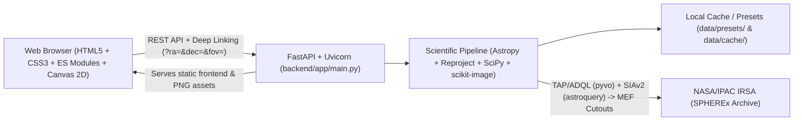

# CepheusLive — Public Multi-Epoch & Multi-Band Web Viewer for NASA SPHEREx

> **NASA Space Apps Challenge 2026 — Hermosillo, Mx**  
> A public, interactive web tool for exploring near-infrared sky time series (`0.75–5.0 µm`, 102 spectral channels across 6 LVF detector arrays `D1–D6`) from NASA's **SPHEREx** mission, designed to help astronomers and citizen scientists easily detect moving objects and photometric variability.

**Live demo of CepheusLive:**
https://grajx-spherex-space-apps-challenge-2026.onrender.com/

<p align="center">
  
  <br />
  <sub>Sequence exported from <code>/api/export/gif</code> for <strong>Barnard's Star (GJ 699)</strong> in temporal difference mode with proper motion trajectory and <code>MJD</code> timestamp.</sub>
</p>

---

## Key Features

### 1. Flexible Sky Search & Quadrant Map (`Q1–Q4`)
- **Multi-format input (`SkySearchBar.js`, `/api/coordinates/parse`)**: accepts ICRS coordinates in decimal degrees (`269.45208, 4.69336`), sexagesimal (`08h55m10.831s -7d14m42.53s`, `17:57:48.50 +04:41:36.1`, `° ' "` symbols), benchmark target names/aliases, and object name resolution via **Sesame/SIMBAD** (`SkyCoord.from_name`).
- **Interactive Sky Map**: 2D Canvas visualization split by quadrants (`Q1`–`Q4`) featuring the galactic plane, ecliptic plane, field stars, and clickable markers for the 5 benchmark targets.
- **Field of View (`FOV`) control**: slider from `1.0'` to `30.0'` with upfront estimation of frame count, payload size (MB), and transfer time (`/api/estimate`).
- **Selectable data source**: `auto` (local cache or live IRSA), `cache` (local FITS), or `live` (direct query to NASA/IPAC IRSA).

### 2. Multi-Epoch Player & Scientific Modes (`BlinkPlayer.js`, `/api/frames`)
- **5 visualization modes**:
  - `rgb` (**RGB Color**, default): per-epoch false-color composite combining all 6 detectors (`R = D5/D6`, `G = D3/D4`, `B = D1/D2`).
  - `diff` (**Difference**): detector-aware subtraction ($I_t - I_{\text{median}}$) rendered with a diverging `RdBu_r` colormap to highlight proper-motion dipoles and brightness changes.
  - `blink` (**Blink Comparator**): chronological frame-by-frame blinking across epochs.
  - `stack` (**Co-add / Stack**): median stacking (`median`) to reject cosmic rays and boost the signal-to-noise ratio (SNR).
  - `curtain` (**Sliding Curtain**): interactive split-screen comparator by dragging the divider between epochs.
- **Non-linear astronomical stretch**: `asinh`, `zscale`, and `percentile` with safe `NaN`/`Inf` handling and standard North-up orientation (`flip_north_up`).
- **Automated motion & streak detection (`motion_detector.py`)**:
  - **$3\sigma$ mask**: robust MAD-based thresholding + morphological opening + small-object removal.
  - **Streaklet detection**: Gaussian smoothing + Canny edges + probabilistic Hough transform (`scikit-image`).
  - **Temporal trajectory (`TrajectoryPoint`)**: sub-pixel centroid tracking and cumulative displacement in arcseconds (`arcsec`).
- **GIF export (`/api/export/gif`)**: downloads animations stamped with `UTC`/`MJD`, detector, wavelength ($\mu\text{m}$), and overlaid trajectory.

### 3. LVF Detectors (`D1–D6`) & On-the-Fly Spectroscopy
- **Band selector (`DetectorSelector.js`)**: filters and variance-weighted co-adds ($1/\text{VARIANCE}$) exposures for `All`, `D1`–`D6` (`0.75–5.0 µm`), or `RGB composite`.
- **On-the-fly spectrum (`SpectrumChart.js`, `/api/spectrum`)**: clicking or dragging over any pixel in the viewer performs circular aperture photometry with local background subtraction (*annulus*) across reprojected exposures, displaying flux (`MJy/sr`), error bars, channels with active `FLAGS`, and molecular signature identification ($\text{H}_2\text{O}$, $\text{CH}_4$, $\text{CO}$, $\text{CO}_2$).

### 4. Multi-Mission Comparison, Metadata & Accessibility
- **SPHEREx / AllWISE / Gaia DR3 comparator (`AladinOverlay.js`)**: `WISE`, `Gaia`, and `Split` modes to compare the historical AllWISE (2010) baseline and Gaia DR3 astrometric vectors against the current SPHEREx frame.
- **Metadata & quality traffic light (`MetadataPanel.js`)**: `FLAGS` bitmask decoding (`cosmic_ray`, `saturated`, `hot_dead_pixel`, `persistence`, `stray_light`, `missing_data`), status (`ok`, `warning`, `bad`), contamination fraction, and exposure telemetry.
- **Shareable URLs & `<iframe>` embed (`EmbedModal.js`, `state.js`)**: two-way URL parameter synchronization and `<iframe>` snippet generator with clean embed mode (`embed=1`).
- **Accessibility & internationalization (`SettingsPanel.js`, `i18n.js`, `accessibility.css`)**:
  - Supported languages: **English (`en`, default)**, **Español (`es`)**, and **Français (`fr`)**.
  - **Dark / Light** theme persisted in `localStorage`, automatic support for `prefers-reduced-motion`, and keyboard shortcuts (`Space`/`k` Play/Pause, `←`/`→` previous/next epoch, `m` cycle mode).

---

## System Architecture



- **Backend (`backend/app/`)**: **FastAPI** REST API with mandatory WCS reprojection (`reproject.reproject_interp` onto a tangent `RA---TAN` / `DEC--TAN` grid) prior to any cross-epoch operation, Multi-Extension FITS (`IMAGE`, `VARIANCE`, `FLAGS`) handling, **NASA/IPAC IRSA** client with dynamic discovery of `spherex*` collections, concurrent spatial *cutout* downloads, and deterministic local *fallback*.
- **Frontend (`frontend/`)**: modular **JavaScript ES Modules (`type="module"`)** and **Canvas 2D** application with *zero-build* setup, served directly by FastAPI.

---

## Local Installation & Running

### Requirements
- **Python 3.11+** (developed and tested on **Python 3.14.10**).
- No Node.js or frontend build step required.

### 1. Clone the repository and set up the virtual environment

```bash
git clone https://github.com/CrisQuinteroC/GrajX---SPHEREx---Space-Apps-Challenge-2026---Hermosillo-Mx.git
cd GrajX---SPHEREx---Space-Apps-Challenge-2026---Hermosillo-Mx

python -m venv .venv
source .venv/bin/activate
pip install -r backend/requirements.txt
```

### 2. Start the server

```bash
python run_app.py
```

Or directly with Uvicorn:

```bash
uvicorn backend.app.main:app --host 127.0.0.1 --port 8000 --reload
```

### 3. Local URLs
- **Main Web Viewer:** `http://127.0.0.1:8000/`
- **Interactive Backend Debug Console:** `http://127.0.0.1:8000/debug`
- **OpenAPI Docs (Swagger):** `http://127.0.0.1:8000/docs`
- **ReDoc:** `http://127.0.0.1:8000/redoc`

---

## REST API & Deep Linking

### Core Endpoints

| Method & Path | Description | Key Parameters |
|---|---|---|
| `GET /api/health` | API status, Python version, presets on disk, and IRSA connectivity | — |
| `GET /api/presets` | Catalog of the 5 required benchmark targets | — |
| `GET /api/coordinates/parse` | Normalizes decimal, sexagesimal, or name input to ICRS | `ra`, `dec?` |
| `GET /api/estimate` | Estimates frame count, MB size, and transfer time for a given FOV | `ra`, `dec?`, `fov` |
| `GET /api/frames` | Reprojected PNG time series, WCS, `FLAGS`, trajectory, and $3\sigma$ mask | `ra`, `dec?`, `fov`, `mode`, `detector`, `stretch`, `include_mask`, `source` |
| `GET /api/spectrum` | Photometric spectrum extraction (`0.75–5.0 µm`) and molecular bands | `ra`, `dec?`, `fov`, `target_ra?`, `target_dec?`, `px?`, `py?`, `aperture_arcsec`, `source` |
| `GET /api/export/gif` | Generates and downloads an animated GIF with `UTC`/`MJD` stamp | `ra`, `dec?`, `fov`, `mode`, `detector`, `stretch`, `fps`, `source` |
| `GET /api/assets/{cache_key}/{filename}` | Serves cached PNG frames and mask overlays | `cache_key`, `filename` |

### Shareable URL Parameters & `iframe` Embedding
Viewer state is automatically synced with the browser address bar:

```text
/?ra=133.79513&dec=-7.24515&fov=6.0&mode=rgb&detector=D5&stretch=asinh&source=auto&fps=2.0&mask=1&trajectory=1&play=1&preset=wise_0855&embed=1
```

Appending `embed=1` (or using the share button in the UI) hides the header, search bar, inspector panel, and footer so the viewer renders full-bleed inside an `<iframe>`.

---

## Automated Tests

The backend includes unit and integration tests covering ICRS coordinate parsing, the FITS MEF / WCS reprojection / spectrum / GIF pipeline, and the FastAPI REST endpoints:

```bash
.venv/bin/python -m unittest discover -s backend/tests -v
```

---

## Repository Structure

```text
.
├── run_app.py                          # Quick local launcher (Uvicorn on 127.0.0.1:8000)
├── requirements.txt                    # Top-level workspace dependencies
├── COORDENADAS_BUSQUEDA.md             # Manual coordinate lookup guide by quadrant (Q1–Q4)
├── barnards_diff.gif                   # Sample GIF exported in difference mode
├── backend/
│   ├── requirements.txt                # Python dependencies for FastAPI + Astropy backend
│   ├── FRONTEND_INTEGRATION_GUIDE.md   # REST integration guide and API contracts
│   ├── app/
│   │   ├── main.py                     # FastAPI app, frontend mount, CORS & endpoints
│   │   ├── config.py                   # Paths, IRSA parameters, D1–D6 bands & FLAGS bits
│   │   ├── models.py                   # Pydantic schemas and enumerations
│   │   ├── irsa_client.py              # IRSA TAP/SIAv2 client, ICRS parsing & cache
│   │   ├── fits_processor.py           # MEF reading, WCS reprojection, stretch & spectrum
│   │   ├── motion_detector.py          # Stacking, subtraction, 3σ mask, streaklets & GIF
│   │   ├── presets.py                  # 5-target benchmark catalog & local MEF generator
│   │   └── debug_ui.py                 # Interactive HTML console at /debug
│   ├── context/                        # Backend technical specifications
│   └── tests/                          # Unit and integration tests (unittest)
├── frontend/
│   ├── index.html                      # Accessible HTML shell for the application
│   ├── css/                            # tokens.css, accessibility.css, style.css
│   └── js/
│       ├── app.js                      # Main orchestrator and keyboard shortcuts
│       ├── state.js                    # Reactive store and URL sync (deep linking)
│       ├── api.js                      # HTTP REST client with synthetic fallback
│       ├── i18n.js                     # Multi-language dictionaries (en, es, fr)
│       └── components/                 # SkySearchBar, BlinkPlayer, DetectorSelector,
│                                       # SpectrumChart, AladinOverlay, MetadataPanel,
│                                       # EmbedModal, SettingsPanel
├── frontend_context/                   # Universal design, UI/UX & accessibility guides
├── data/
│   ├── presets/                        # Pre-cached MEF FITS sequences (5 presets)
│   └── cache/                          # Temporary cache for IRSA downloads & PNG assets
└── NEOSSAT_Tutorial/                   # Original FITS processing algorithmic reference
```

---

## Licenses & Attributions

- This project is distributed under the **GNU General Public License v3.0** — see [`LICENSE`](./LICENSE).
- The core FITS processing, median stacking, temporal subtraction, and motion detection algorithms take educational inspiration from the Canadian Space Agency (CSA/ASC) [`NEOSSAT_Tutorial/`](./NEOSSAT_Tutorial/README.md) repository, licensed under [`NEOSSAT_Tutorial/LICENSE.txt`](./NEOSSAT_Tutorial/LICENSE.txt).
- Scientific data and archive protocols follow the **NASA/IPAC Infrared Science Archive (IRSA)** infrastructure for the **SPHEREx** mission.
