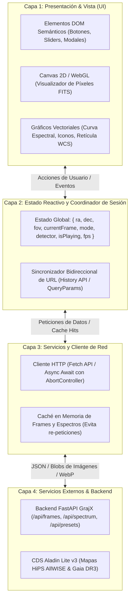

# 🏛️ 01. Principios y Arquitectura Frontend Agnóstica

Este documento establece la **arquitectura del frontend sin presuponer ningún framework ni lenguaje de programación específico** (es igualmente aplicable para JavaScript moderno nativo, TypeScript, React, Svelte, Vue, Solid o Web Components).

---

## 1. Patrón Arquitectónico en 4 Capas Desacopladas

Para garantizar que el código sea limpio, mantenible y testeable, la aplicación se divide en 4 capas estrictas con responsabilidades unidireccionales:



---

## 2. Contrato de Datos con el Backend (API REST)

Toda implementación de frontend debe respetar y consumir las siguientes estructuras de datos enviadas por el backend de GrajX:

### A) `GET /api/presets`
Devuelve el catálogo de los 5 objetos de prueba obligatorios con información amigable para las tarjetas de selección rápida.

**Respuesta JSON esperada:**
```json
[
  {
    "id": "barnards_star",
    "name": "Barnard's Star (Estrella de Barnard)",
    "friendly_title": "La Estrella Veloz",
    "category": "moving_star",
    "description": "El objeto estelar con el movimiento propio más rápido del cielo nocturno.",
    "ra": 269.45208,
    "dec": 4.69336,
    "recommended_fov": 5.0,
    "recommended_mode": "diff",
    "thumbnail_url": "/assets/presets/barnard.webp",
    "fun_fact": "¡En solo una vida humana se desplaza la mitad del tamaño de la Luna llena!"
  },
  {
    "id": "wise_0855",
    "name": "WISE 0855−0714",
    "friendly_title": "El Mundo Helado Invisible",
    "category": "brown_dwarf",
    "description": "Una enana marrón a solo 7 años luz, casi a temperatura de congelación (250 K).",
    "ra": 133.79513,
    "dec": -7.24515,
    "recommended_fov": 6.0,
    "recommended_mode": "blink",
    "thumbnail_url": "/assets/presets/wise0855.webp",
    "fun_fact": "¡Es totalmente invisible a los ojos humanos! Solo telescopios infrarrojos como SPHEREx pueden verla."
  }
]
```

### B) `GET /api/frames?ra={ra}&dec={dec}&fov={fov}&mode={mode}&detector={detector}`
Devuelve la lista ordenada cronológicamente de cuadros listos para renderizar en el *Blink Player*.

**Parámetros:**
- `ra` (float): Ascensión Recta en grados (0.0 a 360.0).
- `dec` (float): Declinación en grados (-90.0 a +90.0).
- `fov` (float): Campo de visión en minutos de arco (ej. 2.0 a 30.0).
- `mode` (string): `"blink"` (originales calibrados), `"stack"` (coadición/mediana) o `"diff"` (resta temporal $I_t - I_{\text{mediana}}$).
- `detector` (string): `"all"`, `"D1"`, `"D2"`, `"D3"`, `"D4"`, `"D5"`, `"D6"`, o `"rgb"`.

**Respuesta JSON esperada:**
```json
{
  "target": { "ra": 133.79513, "dec": -7.24515, "fov_arcmin": 6.0 },
  "total_frames": 4,
  "frames": [
    {
      "frame_index": 0,
      "epoch_id": "2025-06-15",
      "observation_date_utc": "2025-06-15T14:22:10Z",
      "mjd": 60841.598,
      "detector": "D5",
      "wavelength_range_um": [3.82, 4.42],
      "image_url": "/api/cache/frames/frame_0_d5.webp",
      "exposure_seconds": 120.0,
      "quality": {
        "status": "excellent",
        "score_percent": 98,
        "flags_detected": [],
        "friendly_message": "Cielo despejado sin anomalías de detector."
      }
    }
  ]
}
```

### C) `GET /api/spectrum?ra={ra}&dec={dec}&target_ra={target_ra}&target_dec={target_dec}`
Devuelve el flujo electromagnético a lo largo de las 102 bandas ($0.75\text{–}5.0\,\mu\text{m}$) al hacer clic en cualquier píxel.

**Respuesta JSON esperada:**
```json
{
  "coordinates": { "ra": 133.79513, "dec": -7.24515 },
  "spectral_points": [
    { "wavelength_um": 0.75, "flux_mjy_sr": 1.25, "error_mjy_sr": 0.05, "detector": "D1" },
    { "wavelength_um": 3.05, "flux_mjy_sr": 8.42, "error_mjy_sr": 0.12, "detector": "D4", "absorption_feature": "H2O Ice (Hielo de Agua)" }
  ],
  "detected_molecules": [
    { "name": "Vapor de Agua / Hielo (H₂O)", "wavelength_um": 3.05, "confidence": "Alta" },
    { "name": "Monóxido de Carbono (CO)", "wavelength_um": 4.67, "confidence": "Media" }
  ],
  "interpretation": "La firma espectral indica un cuerpo muy frío dominado por absorciones moleculares de agua y metano."
}
```

---

## 3. Sincronización Bidireccional de la URL (Deep Linking & Embed)

Cualquier cambio de vista debe sincronizarse en tiempo real con la URL mediante la API estándar del navegador (`window.history.replaceState`):

```
https://grajx.spaceapps.org/?ra=133.79513&dec=-7.24515&fov=6&mode=blink&detector=D5&fps=3&embed=0
```

### Reglas de Sincronización:
1. **Sin recarga de página:** Los cambios en sliders o botones de presets deben mutar la Query String sin recargar (`replaceState`).
2. **Copia de enlace fiable:** Un botón "Compartir Descubrimiento" debe generar un enlace que, al abrirse en otro dispositivo o navegador, reconstruya exactamente la misma vista, fotograma y zoom.
3. **Modo `embed=1`:**
   - Si `embed=1` o `embed=true`, la interfaz oculta automáticamente:
     - Barra de navegación superior y pie de página.
     - Controles avanzados de desarrollador.
     - Márgenes exteriores y fondo decorativo.
   - Deja visible únicamente: el reproductor de imágenes, el botón Play/Pausa, el scrubber de épocas y un botón discreto en la esquina: *"Explorar en GrajX ↗"*.
   - Este modo es óptimo para **`<iframe>`** en blogs científicos, notas de prensa y plataformas educativas.

---

## 4. Gestión de Rendimiento Gráfico (60 FPS & Memoria)

Dado que las secuencias de imágenes astronómicas pueden pesar varios megabytes y el usuario puede cambiar la velocidad de parpadeo rápidamente:
- **Precarga de imágenes (`Image Preloading`):** Antes de iniciar la animación automática, las imágenes de todos los fotogramas de la época deben precargarse en memoria mediante objetos `new Image()` o blobs locales.
- **Renderizado en Canvas / WebGL:** Utilizar un único elemento `<canvas>` donde se dibuja el cuadro activo mediante `ctx.drawImage()` en lugar de alternar visibilidad de etiquetas `` en el DOM (evita parpadeos en blanco o caídas de framerate).
- **Control de Timing con `requestAnimationFrame`:** No usar `setInterval` ciego para el parpadeo; calcular delta de tiempo entre frames usando `performance.now()` para una animación suave y sincronizada con la tasa de refresco de la pantalla.
- **Cancelación de Peticiones (`AbortController`):** Si el usuario arrastra un slider de FOV o cambia rápidamente entre presets, cancelar peticiones HTTP previas en vuelo con `abortController.abort()` para no saturar el ancho de banda.
